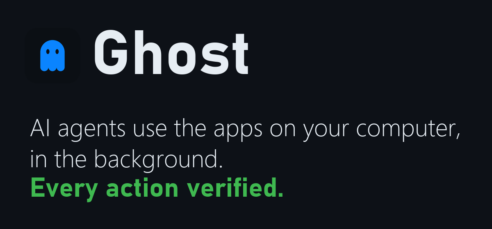
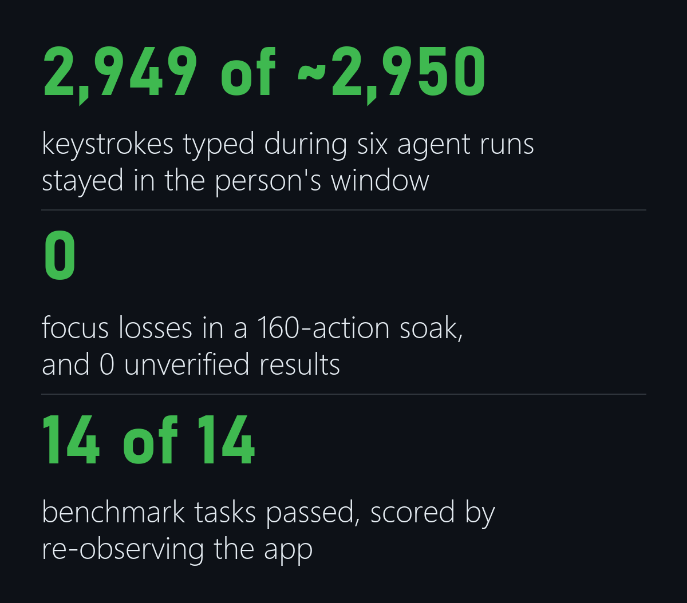

<div align="center">



[](https://github.com/NORTHTEKDevs/ghost/actions/workflows/ci.yml)
[](https://github.com/NORTHTEKDevs/ghost/releases/latest)
[](LICENSE)

**[Quick start](#quick-start)** · [Connect](#2-connect-your-client) · [Try it](#3-try-it) · [Safety](#safety-model) · [Docs](docs/README.md)

</div>

<p align="center">
  <a href="assets/demo.gif"></a>
</p>

An agent drives an app on Ghost's hidden desktop, never on your screen. Recorded,
not drawn: [recording script](scripts/demo-capture.mjs) ·
[full-width recording](assets/demo.gif).

Ghost is an [MCP](https://modelcontextprotocol.io) server, a CLI and a local
REST API. It gives an agent the operating system's own control surface: the
windows and controls of any app, including the ones with no API, plus the
shell and the browser you are already signed into.

It reads apps through the OS accessibility layer (UI Automation on Windows,
AT-SPI2 on Linux), so the agent gets real buttons and fields with names, not
pixels to guess at.

## Two promises, measured

**It does not take your screen.** Agents click, type and scroll inside apps
while you keep working in another window. Apps Ghost starts run on a hidden
desktop you never see, and the focus policy is locked so an agent cannot
decide to take your mouse; only you can unlock it, in the server's config.

**Every action is verified.** After acting, Ghost re-reads the control or the
screen and returns <code>verified:&nbsp;true</code> only when the change really happened; a
call it cannot complete fails with an error that says why.

<p align="center">
  
</p>

How these were measured: [background mode](docs/background-mode.md#when-an-app-takes-the-foreground-itself)
(including the one keystroke that strayed) and [benchmarks](docs/benchmarks.md).
To check both claims on your own hardware, run the `ghost verify` command from
step 3; it exits non-zero if a claim does not hold. And you stay in charge: see
the [safety model](#safety-model).

## Quick start

Three steps: install, connect your client, try it.

### 1. Install

Runs on Windows 10 (build 19041+) and 11, and Linux x86_64 (X11 verified,
Wayland not yet). No macOS yet: see [platform support](#platform-support).

**Claude Desktop**, one click: from the
[latest release](https://github.com/NORTHTEKDevs/ghost/releases/latest),
download the bundle for your system and open it in *Settings > Extensions >
Install from file*. Done; skip to step 3.

- Windows: `ghost-windows-x64.mcpb`
- Linux: `ghost-linux-x86_64.mcpb`

**Windows** (PowerShell):

```powershell
$raw = "https://raw.githubusercontent.com" +
  "/NORTHTEKDevs/ghost/main/scripts"
irm "$raw/install-windows.ps1" | iex
```

**Linux** (x86_64):

```bash
repo=https://github.com/NORTHTEKDevs/ghost
dl=$repo/releases/latest/download
mkdir -p ghost && cd ghost
curl -L $dl/ghost-linux-x86_64.tar.gz |
  tar -xz && ./install.sh
```

Both installers, with no administrator rights:

- copy the three programs into place: on Windows into
  `%LOCALAPPDATA%\Programs\ghost`, added to your PATH, after checking the
  download's SHA-256 ([read the script](scripts/install-windows.ps1)); on
  Linux into `~/.local/bin`, turning on the desktop accessibility setting;
- register Ghost with Claude Code, if the `claude` CLI is installed;
- finish with `ghost doctor`, which reports PASS, WARN or FAIL for
  everything Ghost needs.

Open a new terminal afterwards so `ghost` is found. On Wayland, read
[platform support](#platform-support) first.

<details>
<summary>Other ways to install</summary>

By hand on Windows, which is what the installer does minus the checksum and
the Claude Code registration:

```powershell
$dir = "$env:LOCALAPPDATA\Programs\ghost"
$dl = "https://github.com/NORTHTEKDevs" +
  "/ghost/releases/latest/download"
iwr "$dl/ghost-windows-x64.zip" `
  -OutFile ghost.zip
Expand-Archive ghost.zip $dir -Force
Get-ChildItem $dir | Unblock-File
& "$dir\ghost.exe" doctor
```

Then add `$dir` to your user PATH. Checksums, provenance, SmartScreen and
building from source: [install guide](docs/install.md).

</details>

### 2. Connect your client

**Claude Code** is already connected if the `claude` CLI was installed when
you ran the installer. To check, or to add it yourself:

```bash
claude mcp list
```

**Windows** (PowerShell):

```powershell
$exe = "$env:LOCALAPPDATA\Programs" +
  "\ghost\ghost-mcp.exe"
claude mcp add ghost -s user -- $exe
```

**Linux**:

```bash
claude mcp add ghost -s user \
  -- "$HOME/.local/bin/ghost-mcp"
```

The other clients take the full path to `ghost-mcp` in a JSON or TOML file.
The examples use the Windows path; on Linux it is
`/home/YOU/.local/bin/ghost-mcp`. Replace `YOU`, or print the exact path with
the last item.

<details>
<summary><b>Claude Desktop</b> (without the bundle)</summary>

Add to `%APPDATA%\Claude\claude_desktop_config.json`, then restart Claude Desktop:

```json
{
  "mcpServers": {
    "ghost": { "command": "C:/Users/YOU/AppData/Local/Programs/ghost/ghost-mcp.exe" }
  }
}
```

</details>

<details>
<summary><b>Cursor</b></summary>

Add to `~/.cursor/mcp.json` (all projects) or `.cursor/mcp.json` (one project):

```json
{
  "mcpServers": {
    "ghost": { "command": "C:/Users/YOU/AppData/Local/Programs/ghost/ghost-mcp.exe" }
  }
}
```

</details>

<details>
<summary><b>VS Code</b> (Copilot agent mode)</summary>

Add to `.vscode/mcp.json`:

```json
{
  "servers": {
    "ghost": { "type": "stdio", "command": "C:/Users/YOU/AppData/Local/Programs/ghost/ghost-mcp.exe" }
  }
}
```

</details>

<details>
<summary><b>Codex CLI</b></summary>

Add to `~/.codex/config.toml`:

```toml
[mcp_servers.ghost]
command = "C:/Users/YOU/AppData/Local/Programs/ghost/ghost-mcp.exe"
```

</details>

<details>
<summary><b>Windsurf, Cline, or any other MCP client</b></summary>

Register `ghost-mcp` as a **stdio** server with no arguments. Most clients take
this shape:

```json
{
  "mcpServers": {
    "ghost": { "command": "C:/Users/YOU/AppData/Local/Programs/ghost/ghost-mcp.exe" }
  }
}
```

Registry-aware clients can also install `io.github.NORTHTEKDevs/ghost` from
the [MCP registry](https://registry.modelcontextprotocol.io).

</details>

<details>
<summary><b>Print the path to paste</b></summary>

Windows (PowerShell):

```powershell
$exe = "$env:LOCALAPPDATA\Programs" +
  "\ghost\ghost-mcp.exe"
$exe.Replace('\', '/')
```

Linux: `readlink -f ~/.local/bin/ghost-mcp`

</details>

### 3. Try it

Restart your client so it picks up the server. Its tool list should now show
the `ghost_*` tools (54 on Windows); if it does not, see
[troubleshooting](#troubleshooting). Then ask your agent something like:

> Use Ghost to list my open windows, then read the text of the one I'm
> working in and summarise it.

To check the whole background-and-verify loop on your machine:

```bash
ghost verify
```

## How an agent uses it

The loop is look, act, confirm:

1. `ghost_see window="Invoice Editor"` returns every control in the window with
   its name, role, state and position. `mode=text` returns the readable text
   instead, about ten times cheaper than an image.
2. `ghost_act name="Save" action="click"` drives the control in the background
   and returns <code>verified:&nbsp;true</code> only when the change shows.
3. `ghost_screenshot` returns pixels when a chart or canvas needs the model's
   own eyes.

Around that loop: `ghost_window` launches, lists and closes windows (on the
hidden desktop by default), `ghost_wait` and `ghost_assert` turn "did it work"
into a check, `ghost_shell` runs builds, git and scripts, and the
`ghost_browser_*` / `ghost_tab_*` tools drive browser tabs over the DevTools
protocol. All 54 tools with every parameter: [tool reference](docs/tools.md).

Not using an agent? The same engine is a CLI and a local REST API:

```bash
ghost list-windows
ghost click --name "Save"
ghost-http --addr 127.0.0.1:7878
curl http://127.0.0.1:7878/list-windows
```

Window anchoring, what every response promises, intents (JSON flows with
retries and conditions), the HTTP API and the Rust SDK:
[using Ghost](docs/usage.md). Runnable scripts: [examples](examples).


## Safety model

Anything that can reach a Ghost server can control the desktop as you, so
Ghost is built around who can reach it, what an agent may do, and how you take
control back.

- **Emergency stop.** <kbd>Ctrl</kbd>+<kbd>Alt</kbd>+<kbd>G</kbd> halts every
  acting call in every Ghost process, releases held keys and ends programs
  Ghost's shells started. Read-only calls keep answering.
- **Human-only resume.** Only you can lift a stop you raised: type
  `ghost reset` in a terminal, or press
  <kbd>Ctrl</kbd>+<kbd>Alt</kbd>+<kbd>Shift</kbd>+<kbd>G</kbd> on the real
  keyboard. An agent's `ghost_reset` is refused.
- **Background lock.** The focus policy is locked to `background`, so an agent
  cannot take your mouse, keyboard or foreground window. Only the operator
  unlocks it, with `GHOST_FOCUS_LOCK=off`.
- **Shell switch.** `ghost_shell` is on by default and has your account's
  rights. `GHOST_SHELL=off` refuses it and blocks launching shells and script
  hosts; `GHOST_LAUNCH_ALLOW` turns launching into an allowlist.
- **SSRF guard.** `ghost_http_get` and `ghost_http_post` resolve the host first,
  refuse loopback, private, link-local and reserved addresses, and ignore proxy
  settings. Browser tabs accept http(s) only.
- **Stop scopes.** `ghost_stop scope=process` stops one server; `everywhere`
  (the default) stops them all. An unknown scope is rejected.
- **Local transports only.** `ghost-mcp` speaks stdio and opens no port.
  `ghost-http` binds loopback only and refuses requests from web pages.
- **Nothing leaves your machine.** No telemetry and no vision API key: your
  agent's own model reads what Ghost returns. The only outbound traffic is the
  optional vision tier, to an endpoint you configure.

Details and limits: [security model](docs/security-model.md). How background
control works and what was measured: [background mode](docs/background-mode.md).

## Platform support

| Platform | Status |
| :--- | :--- |
| **Windows** | Full and verified on 10 (build 19041+) and 11. UI Automation, posted window messages, hidden desktops, DXGI/GDI capture. |
| **Linux&nbsp;X11** | Functional, verified by live CI tests against a real GTK app. AT-SPI2, XTEST, X11 capture. |
| **Linux&nbsp;Wayland** | Implemented, not yet verified on hardware. Same AT-SPI2 layer; input and capture through portals or uinput. Run `ghost doctor` first and please file what you find. |
| **macOS** | Not yet. A compiling scaffold with an implementation map. |

The focus policy and hidden desktops are Windows features. The browser tools
need a Chromium-family browser (Chrome, Edge, Brave or Comet). Full matrix:
[cross-platform](docs/cross-platform.md); Linux setup:
[Fedora and other distros](docs/linux-fedora.md).

## Troubleshooting

<details>
<summary>Windows shows <code>Windows protected your PC</code></summary>

The binaries are not code-signed yet. Choose *More info*, then *Run anyway*, or
[verify the download](docs/install.md#check-where-a-download-came-from) first.

</details>

<details>
<summary>The shell says <code>ghost: command not found</code></summary>

Open a new terminal after installing. On Linux, add `~/.local/bin` to your
`PATH`; the installer prints the line to add.

</details>

<details>
<summary>No <code>ghost_*</code> tools appear in the client</summary>

Use an absolute path to `ghost-mcp` and restart the client. To check the
binary itself:

```bash
ghost-mcp --version
```

</details>

<details>
<summary>A call fails with <code>element not found</code></summary>

The error lists the closest names in that window. `ghost_see` with
`window=` set shows every control and its name.

</details>

<details>
<summary>A call fails with <code>focus policy is locked</code></summary>

By design: that action would take your screen. Let Ghost start the app
(`ghost_window op=launch`) or the browser (`ghost_browser_launch`) and drive
it there.

</details>

<details>
<summary>A call fails with <code>the human stopped Ghost</code></summary>

Someone pressed the emergency stop. Resume with
<kbd>Ctrl</kbd>+<kbd>Alt</kbd>+<kbd>Shift</kbd>+<kbd>G</kbd>, or in a terminal:

```bash
ghost reset
```

</details>

<details>
<summary>Linux windows show no elements</summary>

Turn on the accessibility bus (step 1) and restart the apps. `ghost doctor`
checks this.

</details>

<details>
<summary>An antivirus quarantined Ghost</summary>

See the [antivirus notes](docs/antivirus.md).

</details>

Still stuck? Run `ghost doctor` and
[open an issue](https://github.com/NORTHTEKDevs/ghost/issues/new/choose) with
its output.

## FAQ

**Which apps can it drive?** Anything that exposes accessibility: native Win32,
WinForms, WPF, UWP/WinUI, Electron, Chromium, Qt and GTK. Canvas-only apps
(games, remote desktops) expose little, so the agent relies on screenshots
there.

**How is this different from Playwright or Computer Use?** Playwright drives
web pages; Ghost drives the desktop (and tabs too). Screenshot-based computer
use guesses coordinates from pixels and takes your screen; Ghost acts on named
controls in the background and verifies each action. See the
[comparison](docs/comparison.md).

**Can several agents use it at once?** Yes. Calls run in parallel, and a
second Ghost process runs alongside the first without contending for the mouse.

**How do I update?** Quit your MCP client, then run the installer from step 1
again. To remove Ghost, see [uninstall](docs/install.md#uninstall).

## More

- Guides: [install](docs/install.md), [using Ghost](docs/usage.md), [configuration](docs/configuration.md)
- Proof and safety: [security model](docs/security-model.md), [background mode](docs/background-mode.md), [benchmarks](docs/benchmarks.md)
- Reference: [tools](docs/tools.md), [changelog](CHANGELOG.md), [all docs](docs/README.md)

Pull requests: [CONTRIBUTING.md](CONTRIBUTING.md). Vulnerabilities go through
[SECURITY.md](SECURITY.md), not public issues. [MIT](LICENSE), copyright 2026
Northtek.

Ghost is a general-purpose automation tool. Use it on systems you own or are
authorized to automate, and within the terms of the software you drive.
