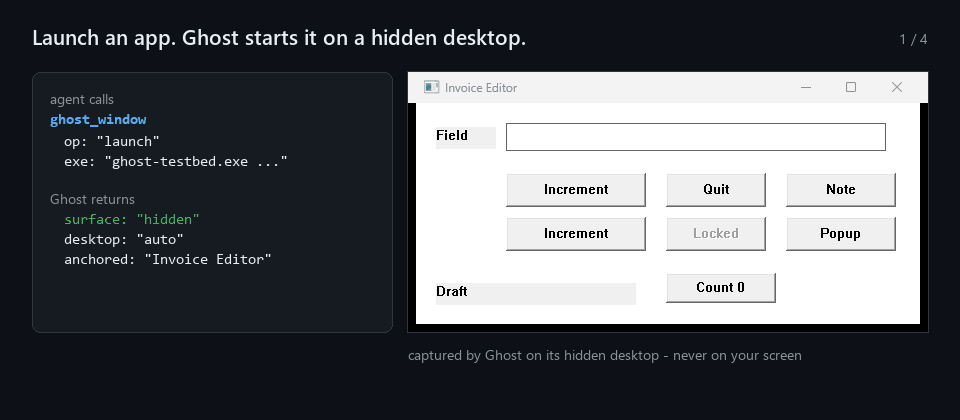

<div align="center">


# Ghost

**Lets AI agents use the apps on your computer, in the background, and proves every action worked.**

[](https://github.com/NORTHTEKDevs/ghost/actions/workflows/ci.yml)
[](https://github.com/NORTHTEKDevs/ghost/actions/workflows/linux.yml)
[](https://github.com/NORTHTEKDevs/ghost/releases/latest)
[](LICENSE)
[](https://registry.modelcontextprotocol.io/v0/servers?search=io.github.NORTHTEKDevs/ghost)

[Quick start](#quick-start) · [Safety](#safety-model) · [Troubleshooting](#troubleshooting) · [Docs](docs/README.md) · [Tool reference](docs/tools.md) · [Changelog](CHANGELOG.md)

</div>

<p align="center">
  
</p>

Ghost is an [MCP](https://modelcontextprotocol.io) server, a CLI and a local
REST API that give an agent (Claude Code, Claude Desktop, Cursor, Codex, VS
Code, or your own script) the operating system's own control surface: the
windows and controls of any app, including the ones with no API, plus the
shell and the browser you are already signed into. It works through the OS
accessibility layer (UI Automation on Windows, AT-SPI2 on Linux), so the agent
gets real buttons and fields with names, not pixels to guess at.

The demo above is recorded, not drawn: [`scripts/demo-capture.mjs`](scripts/demo-capture.mjs)
makes those calls against a test app on Ghost's hidden desktop and
[`scripts/demo-gif.py`](scripts/demo-gif.py) lays out what came back.

## Why Ghost

Two promises, and how they were measured:

**It does not take your screen.** Agents click, type and scroll inside apps
while you keep working in another window. Apps Ghost starts run on a hidden
desktop you never see, and the focus policy is locked so an agent cannot
decide to take your mouse; only you can unlock it, in the server's config.
*Measured:* a person typed into another window while an agent worked; 1 of
about 2,950 keystrokes over six runs landed in the agent's window
([how](docs/background-mode.md#when-an-app-takes-the-foreground-itself)). A
160-action soak lost focus 0 times.

**Every action is verified.** After acting, Ghost re-reads the control or the
screen and returns `verified: true` only when the change really happened; a
call it cannot complete fails with an error that says why. *Measured:* 14 of 14
benchmark tasks passed when scored by re-observing the app, never by trusting
the return value, and 0 unverified results in the soak
([benchmarks](docs/benchmarks.md)).

Check both on your own hardware with `ghost verify`, which exits non-zero if a
claim does not hold. And you stay in charge: see the [safety model](#safety-model).

## Quick start

### 1. Install

Runs on Windows 10 (build 19041+) and 11, and Linux x86_64 (X11 verified,
Wayland not yet). No macOS yet: see [platform support](#platform-support).

**Claude Desktop, one click:** download `ghost-windows-x64.mcpb` (or
`ghost-linux-x86_64.mcpb`) from the
[latest release](https://github.com/NORTHTEKDevs/ghost/releases/latest) and
open it: *Settings -> Extensions -> Install from file*. Done; skip to step 3.

**Windows** (PowerShell):

```powershell
$dir = "$env:LOCALAPPDATA\Programs\ghost"
$url = "https://github.com/NORTHTEKDevs/ghost/releases/latest/download"
Invoke-WebRequest "$url/ghost-windows-x64.zip" -OutFile ghost.zip
Expand-Archive ghost.zip -DestinationPath $dir -Force
Get-ChildItem $dir | Unblock-File
$path = [Environment]::GetEnvironmentVariable("Path", "User")
if ($path -notlike "*$dir*") {
  [Environment]::SetEnvironmentVariable("Path", "$path;$dir", "User")
}
& "$dir\ghost.exe" doctor
```

Open a new terminal afterwards so `ghost` is on your PATH. To update later,
quit your MCP client and run the same block again.

**Linux** (x86_64):

```bash
url=https://github.com/NORTHTEKDevs/ghost/releases/latest/download
mkdir -p ghost-download ~/.local/bin
curl -L "$url/ghost-linux-x86_64.tar.gz" | tar -xz -C ghost-download
cd ghost-download && install -m 0755 ghost ghost-mcp ghost-http ~/.local/bin/
gsettings set org.gnome.desktop.interface toolkit-accessibility true
~/.local/bin/ghost doctor
```

If `ghost` is not found afterwards, add `~/.local/bin` to your PATH
(`export PATH="$HOME/.local/bin:$PATH"` in your shell's rc file).

`ghost doctor` reports PASS, WARN or FAIL for everything Ghost needs. On
Wayland, run it and read [platform support](#platform-support) first.
Checksums, provenance, SmartScreen, building from source:
[docs/install.md](docs/install.md).

### 2. Connect your client

<details open>
<summary><b>Claude Code</b></summary>

Windows (PowerShell):

```powershell
claude mcp add ghost --scope user -- "$env:LOCALAPPDATA\Programs\ghost\ghost-mcp.exe"
```

Linux:

```bash
claude mcp add ghost --scope user -- "$HOME/.local/bin/ghost-mcp"
```

</details>

The other clients take a JSON or TOML file, which cannot expand variables, so
replace `YOU` with your user name. The Windows path is shown; on Linux use
`/home/YOU/.local/bin/ghost-mcp`.

<details>
<summary><b>Claude Desktop</b> (without the bundle)</summary>

Add to `%APPDATA%\Claude\claude_desktop_config.json`, then restart Claude Desktop:

```json
{
  "mcpServers": {
    "ghost": { "command": "C:/Users/YOU/AppData/Local/Programs/ghost/ghost-mcp.exe" }
  }
}
```

</details>

<details>
<summary><b>Cursor</b></summary>

Add to `~/.cursor/mcp.json` (all projects) or `.cursor/mcp.json` (one project):

```json
{
  "mcpServers": {
    "ghost": { "command": "C:/Users/YOU/AppData/Local/Programs/ghost/ghost-mcp.exe" }
  }
}
```

</details>

<details>
<summary><b>VS Code</b> (Copilot agent mode)</summary>

Add to `.vscode/mcp.json`:

```json
{
  "servers": {
    "ghost": { "type": "stdio", "command": "C:/Users/YOU/AppData/Local/Programs/ghost/ghost-mcp.exe" }
  }
}
```

</details>

<details>
<summary><b>Codex CLI</b></summary>

Add to `~/.codex/config.toml`:

```toml
[mcp_servers.ghost]
command = "C:/Users/YOU/AppData/Local/Programs/ghost/ghost-mcp.exe"
```

</details>

<details>
<summary><b>Windsurf, Cline, or any other MCP client</b></summary>

Register `ghost-mcp` as a **stdio** server with no arguments. Most clients take
this shape:

```json
{
  "mcpServers": {
    "ghost": { "command": "/home/YOU/.local/bin/ghost-mcp" }
  }
}
```

Registry-aware clients can also install `io.github.NORTHTEKDevs/ghost` from
the [MCP registry](https://registry.modelcontextprotocol.io).

</details>

### 3. Try it

Restart your client so it picks up the server. Its tool list should now show
the `ghost_*` tools (54 on Windows); if it does not, see
[troubleshooting](#troubleshooting). Then ask your agent something like:

> Use Ghost to list my open windows, then read the text of the one I'm
> working in and summarise it.

To check the whole background-and-verify loop on your machine:

```bash
ghost verify
```

## How an agent uses it

The loop is look, act, confirm:

1. `ghost_see window="Invoice Editor"` returns every control in the window with
   its name, role, state and position. `mode=text` returns the readable text
   instead, about ten times cheaper than an image.
2. `ghost_act name="Save" action="click"` drives the control in the background
   and returns `verified: true` only when the change shows.
3. `ghost_screenshot` returns pixels when a chart or canvas needs the model's
   own eyes.

Around that loop: `ghost_window` launches, lists and closes windows (on the
hidden desktop by default), `ghost_wait` and `ghost_assert` turn "did it work"
into a check, `ghost_shell` runs builds, git and scripts, and the
`ghost_browser_*` / `ghost_tab_*` tools drive browser tabs over the DevTools
protocol. All 54 tools with every parameter: [docs/tools.md](docs/tools.md).

Not using an agent? The same engine is a CLI and a local REST API:

```bash
ghost list-windows
ghost click --name "Save"
ghost-http --addr 127.0.0.1:7878   # then: curl http://127.0.0.1:7878/list-windows
```

Window anchoring, what every response promises, intents (JSON flows with
retries and conditions), the HTTP API and the Rust SDK:
[docs/usage.md](docs/usage.md). Runnable scripts: [`examples/`](examples).

## Safety model

Anything that can reach a Ghost server can control the desktop as you, so
Ghost is built around who can reach it, what an agent may do, and how you take
control back.

- **Emergency stop.** <kbd>Ctrl</kbd>+<kbd>Alt</kbd>+<kbd>G</kbd> halts every
  acting call in every Ghost process, releases held keys and ends programs
  Ghost's shells started. Read-only calls keep answering.
- **Human-only resume.** A stop you raised can only be lifted by you:
  <kbd>Ctrl</kbd>+<kbd>Alt</kbd>+<kbd>Shift</kbd>+<kbd>G</kbd> on the real
  keyboard, or `ghost reset` typed in a terminal. An agent's `ghost_reset` is
  refused.
- **Background lock.** The focus policy is locked to `background`, so an agent
  cannot take your mouse, keyboard or foreground window. Only the operator
  unlocks it (`GHOST_FOCUS_LOCK=off`).
- **Shell switch.** `ghost_shell` is on by default and has your account's
  rights. `GHOST_SHELL=off` refuses it and blocks launching shells and script
  hosts; `GHOST_LAUNCH_ALLOW` turns launching into an allowlist.
- **SSRF guard.** `ghost_http_get` and `ghost_http_post` resolve the host first,
  refuse loopback, private, link-local and reserved addresses, and ignore proxy
  settings. Browser tabs accept http(s) only.
- **Stop scopes.** `ghost_stop scope=process` stops one server; `everywhere`
  (the default) stops them all. An unknown scope is rejected.
- **Local transports only.** `ghost-mcp` speaks stdio and opens no port.
  `ghost-http` binds loopback only and refuses requests from web pages.
- **Nothing leaves your machine.** No telemetry and no vision API key: your
  agent's own model reads what Ghost returns. The only outbound traffic is the
  optional vision tier, to an endpoint you configure.

Details and limits: [docs/security-model.md](docs/security-model.md). How
background control works and what was measured:
[docs/background-mode.md](docs/background-mode.md).

## Platform support

| Platform | Status |
| --- | --- |
| **Windows 10 (19041+) and 11** | Full and verified. UI Automation, posted window messages, hidden desktops, DXGI/GDI capture. |
| **Linux, X11** | Functional, verified by live CI tests against a real GTK app. AT-SPI2, XTEST, X11 capture. |
| **Linux, Wayland** | Implemented, not yet verified on hardware. Same AT-SPI2 layer; input and capture through portals or uinput. Run `ghost doctor` first and please file what you find. |
| **macOS** | Not yet. A compiling scaffold with an implementation map. |

The focus policy and hidden desktops are Windows features. The browser tools
need a Chromium-family browser (Chrome, Edge, Brave or Comet). Full matrix:
[docs/cross-platform.md](docs/cross-platform.md); Linux setup:
[docs/linux-fedora.md](docs/linux-fedora.md).

## Troubleshooting

**"Windows protected your PC" on first run.** The binaries are not code-signed
yet. Choose *More info -> Run anyway*, or
[verify the download](docs/install.md#check-where-a-download-came-from) first.

**`ghost: command not found`.** Open a new terminal after installing. On Linux,
add `export PATH="$HOME/.local/bin:$PATH"` to your shell's rc file.

**The Ghost tools do not appear in the client.** Use an absolute path to
`ghost-mcp`, restart the client, and check that `ghost-mcp --version` prints a
version.

**"element not found".** The error lists the closest names in that window;
`ghost_see window="..."` shows every control and its name.

**"focus policy is locked".** By design: that action would take your screen.
Let Ghost start the app (`ghost_window op=launch`) or the browser
(`ghost_browser_launch`) and drive it there.

**"the human stopped Ghost".** Someone pressed the emergency stop. Resume with
<kbd>Ctrl</kbd>+<kbd>Alt</kbd>+<kbd>Shift</kbd>+<kbd>G</kbd> or `ghost reset`.

**Linux: windows have no elements.** Turn on the accessibility bus (step 1) and
restart the apps; `ghost doctor` checks this.

**An antivirus quarantined Ghost.** See [docs/antivirus.md](docs/antivirus.md).

Still stuck? [Open an issue](https://github.com/NORTHTEKDevs/ghost/issues/new/choose)
with the output of `ghost doctor`.

## FAQ

**Which apps can it drive?** Anything that exposes accessibility: native Win32,
WinForms, WPF, UWP/WinUI, Electron, Chromium, Qt and GTK. Canvas-only apps
(games, remote desktops) expose little, so the agent relies on screenshots
there.

**How is this different from Playwright or Computer Use?** Playwright drives
web pages; Ghost drives the desktop (and tabs too). Screenshot-based computer
use guesses coordinates from pixels and takes your screen; Ghost acts on named
controls in the background and verifies each action. See
[docs/comparison.md](docs/comparison.md).

**Can several agents use it at once?** Yes. Calls run in parallel, and a
second Ghost process runs alongside the first without contending for the mouse.

**How do I update?** Quit your MCP client, then re-run the install block from
step 1. To remove Ghost, see [uninstall](docs/install.md#uninstall).

## Documentation

[Install](docs/install.md) · [Using Ghost](docs/usage.md) · [Configuration](docs/configuration.md) ·
[Security model](docs/security-model.md) · [Background mode](docs/background-mode.md) ·
[Tool reference](docs/tools.md) · [Benchmarks](docs/benchmarks.md) ·
[Linux](docs/linux-fedora.md) · [All docs](docs/README.md)

## Contributing and security

Contributions are welcome: read [CONTRIBUTING.md](CONTRIBUTING.md) and the
[code of conduct](CODE_OF_CONDUCT.md). To report a vulnerability, follow
[SECURITY.md](SECURITY.md) rather than opening a public issue.

## License

[MIT](LICENSE). Copyright 2026 Northtek.

Ghost is a general-purpose automation tool. Use it on systems you own or are
authorized to automate, and within the terms of the software you drive.
