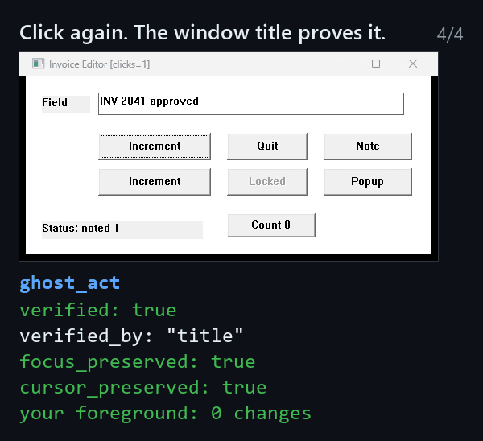

<div align="center">


# Ghost

**Lets AI agents use the apps on your computer, in the background, and proves every action worked.**

[](https://github.com/NORTHTEKDevs/ghost/actions/workflows/ci.yml)
[](https://github.com/NORTHTEKDevs/ghost/actions/workflows/linux.yml)
[](https://github.com/NORTHTEKDevs/ghost/releases/latest)

**[Install](#install)** · [Safety](#safety-model) · [Troubleshooting](#troubleshooting) · [Docs](docs/README.md) · [Changelog](CHANGELOG.md)

</div>

## Install

Windows 10 (build 19041+) or 11, in PowerShell:

```powershell
$s = "raw.githubusercontent.com"
$p = "NORTHTEKDevs/ghost/main"
$f = "scripts/install-windows.ps1"
irm "https://$s/$p/$f" | iex
```

Linux x86_64:

```bash
repo=github.com/NORTHTEKDevs/ghost
file=ghost-linux-x86_64.tar.gz
get=releases/latest/download
mkdir -p ghost && cd ghost
curl -L https://$repo/$get/$file |
  tar -xz && ./install.sh
```

<p align="center">
  <a href="assets/demo.gif"></a>
  <br>
</p>

The demo opens on the result, then plays the run. It was recorded on Ghost's
hidden desktop by `demo-capture.mjs`, not drawn
([script](scripts/demo-capture.mjs), [wide version](assets/demo.gif)).

<details>
<summary>What the installers do</summary>

The Windows block runs [`install-windows.ps1`](scripts/install-windows.ps1)
from this repo; read it first if you like. Both installers need no
administrator rights, register Ghost with Claude Code if the `claude` CLI is
installed, and end with `ghost doctor`, which reports PASS, WARN or FAIL for
each thing Ghost needs. Run either again to update.

The Windows one also checks the download against the release's SHA-256 file;
the Linux one turns on the desktop accessibility setting. Checksums,
provenance and building from source: [the install guide](docs/install.md).

</details>

<details>
<summary>Claude Desktop, without a terminal</summary>

From the [latest release](https://github.com/NORTHTEKDevs/ghost/releases/latest),
download the bundle for your system and open it in *Settings -> Extensions ->
Install from file*:

- `ghost-windows-x64.mcpb`
- `ghost-linux-x86_64.mcpb`

</details>

<details>
<summary>Install by hand on Windows</summary>

```powershell
$d = "$env:LOCALAPPDATA\Programs"
$d = "$d\ghost"
$u = "https://github.com" +
  "/NORTHTEKDevs/ghost/releases" +
  "/latest/download"
iwr "$u/ghost-windows-x64.zip" `
  -OutFile ghost.zip
Expand-Archive ghost.zip $d -Force
Get-ChildItem $d | Unblock-File
& "$d\ghost.exe" doctor
```

Then add `$d` to your PATH. The [installer script](scripts/install-windows.ps1)
does the same, plus the checksum. Checksums, provenance, SmartScreen and
building from source: [the install guide](docs/install.md).

</details>

## Connect another client

Claude Code is set up by the installers, and Claude Desktop by its bundle.
Any other client takes a few lines of config.

<details>
<summary>Cursor, VS Code, Codex, Windsurf, Cline and others</summary>

Every other client needs the absolute path to `ghost-mcp`. Print it on
Windows, in PowerShell:

```powershell
$g = "$env:LOCALAPPDATA\Programs"
$g = "$g\ghost\ghost-mcp.exe"
$g.Replace('\', '/')
```

That prints something like `C:/Users/ana/.../ghost-mcp.exe`
(forward slashes, so JSON needs no escaping). On Linux:

```bash
readlink -f ~/.local/bin/ghost-mcp
```

That prints something like `/home/ana/.local/bin/ghost-mcp`.

Then add a stdio server named `ghost` with that path as its command:

| Client | Where |
| --- | --- |
| Claude Desktop | *Settings -> Developer -> Edit Config* opens its file |
| Cursor | `~/.cursor/mcp.json`, or `.cursor/mcp.json` for one project |
| VS Code (Copilot) | `.vscode/mcp.json`, shape below |
| Windsurf, Cline, others | the client's MCP config, usually under `mcpServers` |

```json
{
  "mcpServers": {
    "ghost": {
      "command": "PASTE_THE_PATH"
    }
  }
}
```

VS Code uses `servers` and a type:

```json
{
  "servers": {
    "ghost": {
      "type": "stdio",
      "command": "PASTE_THE_PATH"
    }
  }
}
```

Codex CLI uses `~/.codex/config.toml`:

```toml
[mcp_servers.ghost]
command = "PASTE_THE_PATH"
```

Restart the client afterwards. Registry-aware clients can also install
`io.github.NORTHTEKDevs/ghost` from the
[MCP registry](https://registry.modelcontextprotocol.io).

</details>

<details>
<summary>Register with Claude Code by hand</summary>

Windows (PowerShell):

```powershell
$g = "$env:LOCALAPPDATA\Programs"
claude mcp add ghost -s user `
  -- "$g\ghost\ghost-mcp.exe"
```

Linux:

```bash
claude mcp add ghost -s user \
  -- "$HOME/.local/bin/ghost-mcp"
```

</details>

## Try it

Restart your client. Its tool list should now show the `ghost_*` tools (54 on
Windows); if not, see [troubleshooting](#troubleshooting). Then give your
agent this prompt:

```text
Use Ghost to list my open windows,
then read the text of the one I'm
working in and summarise it.
```

The agent answers with your window list and a summary, and each Ghost call it
made reports `verified: true`.

## Two promises, measured

**It does not take your screen.** Agents click, type and scroll inside apps
while you keep working in another window. Apps Ghost starts run on a hidden
desktop you never see, and the focus policy is locked so an agent cannot
decide to take your mouse; only you can unlock it, in the server's config.
In six agent runs, 1 stray keystroke in about 2,950 that a person typed left
their window, and a 160-action soak lost focus 0 times
([what strayed, and why](docs/background-mode.md#when-an-app-takes-the-foreground-itself)).

**Every action is verified.** After acting, Ghost re-reads the control or the
screen and returns `verified: true` only when the change really happened; a
call it cannot complete fails with an error that says why. 14 of 14 benchmark
tasks passed when scored by re-observing the app, and the soak had 0
unverified results ([benchmarks](docs/benchmarks.md)).

`ghost verify` checks both on your own hardware and exits non-zero if a claim
does not hold.

## How an agent uses it

The loop is look, act, confirm:

1. `ghost_see window="Invoice Editor"` returns every control in the window with
   its name, role, state and position. `mode=text` returns the readable text
   instead, about ten times cheaper than an image.
2. `ghost_act name="Save" action="click"` drives the control in the background
   and returns `verified: true` only when the change shows.
3. `ghost_screenshot` returns pixels when a chart or canvas needs the model's
   own eyes.

Ghost reads apps through the OS accessibility layer (UI Automation on Windows,
AT-SPI2 on Linux), so the agent gets real buttons and fields with names, not
pixels to guess at. Around the loop are tools that launch and close windows
(on the hidden desktop by default), wait for and assert a condition, run
builds and scripts in a shell, and drive the browser you are signed into over
the DevTools protocol. All 54 tools: [tool reference](docs/tools.md).

Not using an agent? The same engine is a CLI and a local REST API:

```bash
ghost list-windows
ghost click --name "Save"
ghost-http --addr 127.0.0.1:7878
curl 127.0.0.1:7878/list-windows
```

Window anchoring, response guarantees, intents (JSON flows with retries and
conditions), the HTTP API and the Rust SDK: [using Ghost](docs/usage.md).
Runnable scripts: [examples](examples).

## Safety model

Anything that can reach a Ghost server can control the desktop as you. This is
what limits it.

### Who can reach it

- `ghost-mcp` speaks stdio and opens no port. `ghost-http` binds loopback only
  and refuses requests from web pages.
- No telemetry and no vision API key: your agent's own model reads what Ghost
  returns. The only outbound traffic is an optional vision endpoint you set.

### What an agent may do

- The focus policy is locked to background, so an agent cannot take your
  mouse, keyboard or foreground window. Only you unlock it, with
  `GHOST_FOCUS_LOCK=off` in the server's environment.
- The shell tool has your account's rights. `GHOST_SHELL=off` refuses it and
  blocks launching shells and script hosts; `GHOST_LAUNCH_ALLOW` turns
  launching into an allowlist.
- The HTTP tools resolve the host first and refuse loopback, private,
  link-local and reserved addresses. Browser tabs accept http(s) only.

### How you take control back

- <kbd>Ctrl</kbd>+<kbd>Alt</kbd>+<kbd>G</kbd> halts every acting call in every
  Ghost process, releases held keys and ends programs Ghost's shells started.
  Read-only calls keep answering.
- Only you can lift that stop: `ghost reset` in a terminal, or
  <kbd>Ctrl</kbd>+<kbd>Alt</kbd>+<kbd>Shift</kbd>+<kbd>G</kbd> on the real keyboard. An agent's reset is
  refused.

Details and limits: [security model](docs/security-model.md). How background
control works: [background mode](docs/background-mode.md).

## Platform support

| Platform | Status |
| --- | --- |
| Windows | Full and verified on 10 (build 19041+) and 11. UI Automation, posted window messages, hidden desktops, DXGI/GDI capture. |
| Linux, X11 | Functional, verified by live CI tests against a real GTK app. AT-SPI2, XTEST, X11 capture. |
| Linux, Wayland | Implemented, not yet verified on hardware. Run `ghost doctor` first and please file what you find. |
| macOS | Not yet. A compiling scaffold with an implementation map. |

The focus policy and hidden desktops are Windows features. The browser tools
need a Chromium-family browser (Chrome, Edge, Brave or Comet). Full matrix:
[cross-platform](docs/cross-platform.md); Linux setup:
[Fedora and other distros](docs/linux-fedora.md).

## Troubleshooting

| You see | Do this |
| --- | --- |
| "Windows protected your PC" | The binaries are not code-signed yet. *More info -> Run anyway*, or [verify the download](docs/install.md#check-where-a-download-came-from) first. |
| "ghost: command not found" | Open a new terminal. On Linux, add `~/.local/bin` to your `PATH`. |
| No `ghost_*` tools in the client | Use the absolute path to `ghost-mcp`, restart the client, and check `ghost-mcp --version`. |
| "element not found" | The error lists the closest names; `ghost_see` shows every control in the window. |
| "focus policy is locked" | By design. Let Ghost start the app or the browser and drive it there. |
| "the human stopped Ghost" | Someone pressed the emergency stop. Run `ghost reset` in a terminal to resume. |
| Linux windows have no elements | The accessibility setting is off. Re-run `./install.sh`, which turns it on, then restart the apps. |
| Antivirus quarantined Ghost | See [antivirus notes](docs/antivirus.md). |

Still stuck? [Open an issue](https://github.com/NORTHTEKDevs/ghost/issues/new/choose)
with the output of `ghost doctor`.

## FAQ

**Which apps can it drive?** Anything that exposes accessibility: native Win32,
WinForms, WPF, UWP/WinUI, Electron, Chromium, Qt and GTK. Canvas-only apps
(games, remote desktops) expose little, so the agent relies on screenshots
there.

**How is this different from Playwright or Computer Use?** Playwright drives
web pages; Ghost drives the desktop (and tabs too). Screenshot-based computer
use guesses coordinates from pixels and takes your screen; Ghost acts on named
controls in the background and verifies each action. See the
[comparison](docs/comparison.md).

**Can several agents use it at once?** Yes. Calls run in parallel, and a
second Ghost process runs alongside the first without contending for the mouse.

## More

[Install](docs/install.md) · [Using Ghost](docs/usage.md) · [Configuration](docs/configuration.md) ·
[Security model](docs/security-model.md) · [Background mode](docs/background-mode.md) ·
[Benchmarks](docs/benchmarks.md) · [Uninstall](docs/install.md#uninstall) · [All docs](docs/README.md)

Pull requests: [CONTRIBUTING.md](CONTRIBUTING.md). Vulnerabilities go through
[SECURITY.md](SECURITY.md), not public issues. [MIT](LICENSE), copyright 2026
Northtek.

Ghost is a general-purpose automation tool. Use it on systems you own or are
authorized to automate, and within the terms of the software you drive.
